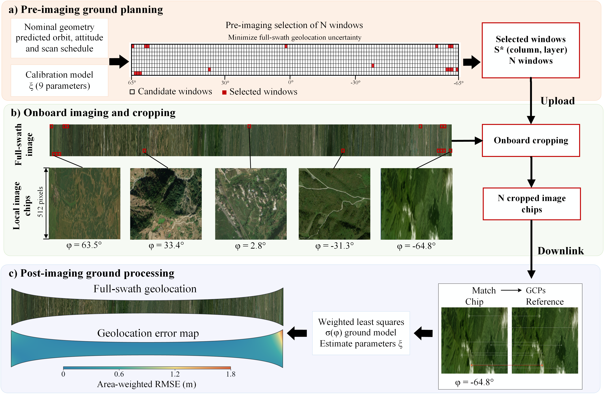
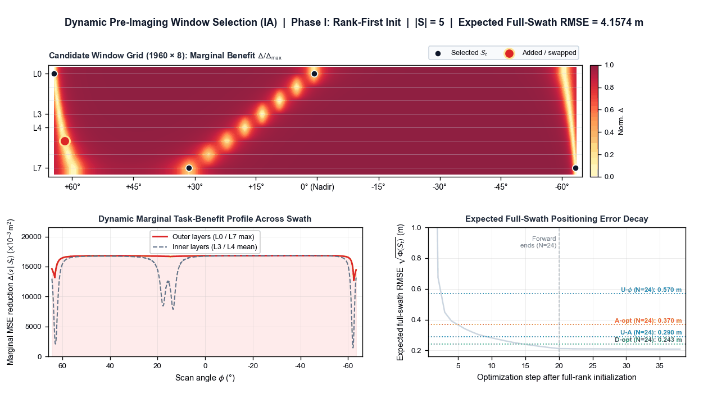

# Pre-Imaging Control-Window Selection for Downlink-Efficient On-Orbit Geometric Calibration of Rotating-Scan Satellites

**Authors:** Zhiming Deng1, Guang Huo2, and Cheng Wei1,*  
1 School of Astronautics, Harbin Institute of Technology, Harbin 150001, China  
2 China Academy of Aerospace System and Innovation, Beijing 100080, China  
* Corresponding author: `weicheng@hit.edu.cn`

  

---

## Overview

Rotating-scan remote sensing satellites achieve both meter-level spatial resolution and ultrawide swath coverage, yet full-image downlink occupies multiple complete data-transmission orbits while ground sampling distance (GSD) expands rapidly with scan angle.

This repository accompanies our manuscript **"Pre-Imaging Control-Window Selection for Downlink-Efficient On-Orbit Geometric Calibration of Rotating-Scan Satellites"**, establishing an integrated framework for **pre-imaging ground window planning, onboard selective cropping and downlink, and post-imaging ground matching and weighted calibration**:

  

### Key Highlights
- **Pre-Imaging Window-Planning Framework:** Formulates calibration control-data acquisition as a pre-imaging discrete subset selection problem over candidate strip windows using only nominal imaging geometry, compressing calibration downlink volume to a few thousandths of the full image (e.g., **0.15%** at $N = 24$).
- **Image-Space Area Measure & Task-Benefit Selection (IA):** Derives an image-space area measure and area-weighted task matrix $Q_{\mathrm{A}}$ aligned with spatially uniform full-swath ground positioning accuracy, propagating focal-plane measurement uncertainty through local pixel-to-ground Jacobians to directly minimize expected full-swath ground MSE $\Phi(\mathcal{S}) = \mathrm{tr}(Q_{\mathrm{A}} F_{\mathcal{S}}^{-1})$.
- **Noise-Scale Invariance & Error-Model Robustness:** Demonstrates both theoretically and experimentally that nominal imaging geometry captures the dominant cross-swath heteroscedasticity of ground observation errors without requiring complex empirical matching-noise priors.

---

## Interactive Dynamic Window-Selection Demonstration

👉 **Launch Interactive App:** **[https://slimyer.github.io/rotating-scan-window-selection/](https://slimyer.github.io/rotating-scan-window-selection/)**

  

The self-contained browser application runs **exact real-time rank-2 matrix updates** across all $1960 \times 8 = 15{,}680$ anonymized candidate detector windows of a nominal $128^\circ$ rotating-scan strip:

1. **Dynamic Step-by-Step Selection:** Step through Phase I (*Rank-First Initialization*), Phase II (*Greedy Forward Selection*), and Phase III (*Single-Window Exchange Refinement*), comparing how the marginal gain landscape $\Delta(s \mid \mathcal{S}_t)$ evolves and migrates across scan angle $\phi$ and detector layers (`L0`–`L7`) under **IA (Ours)**, **D-opt**, and **A-opt**.
2. **Method & Budget Explorer ($N = 8 \dots 48$):** Compare spatial window allocations, outer-layer (`L0/L7`) concentration, remaining uncalibrated task uncertainty, and full-swath positioning RMSE across **IA**, **D-opt**, **A-opt**, **U-A**, and **U-φ** under analytical, Monte Carlo ($n = 400$), and rendered-image benchmarks.
3. **Interactive Sandbox (Click to Design):** Click directly on the $1960 \times 8$ detector grid or curved orbital ground swath to add/remove individual control windows, trigger greedy steps or single-window exchange swaps, and inspect real-time normal-matrix rank, scale-free layout factor $\kappa(\mathcal{S})$, and $\sqrt{\Phi(\mathcal{S})}$.

> **Data Anonymization Note:** Only normalized pre-imaging sensitivity Jacobians, scan angles, local GSDs, and relative cross-track/along-track swath offsets (km) are included in [`docs/`](docs/). No raw satellite telemetry, geographic coordinates, or reference orthophoto imagery are distributed.

---

## Release Roadmap

- [x] Project overview and methodological summary
- [x] Interactive web demonstration ([GitHub Pages](https://slimyer.github.io/rotating-scan-window-selection/)) of step-by-step marginal task-benefit $\Delta(s \mid \mathcal{S}_t)$ evolution and dynamic window selection across budgets $N$
- [ ] Reference Python implementation of the IA forward-selection + multi-start single-window exchange solver and anonymized nominal-geometry benchmark *(to be released upon publication)*

---

## Contact

For questions regarding this work, please contact **Zhiming Deng** (`23b918133@stu.hit.edu.cn`) or **Cheng Wei** (`weicheng@hit.edu.cn`).
